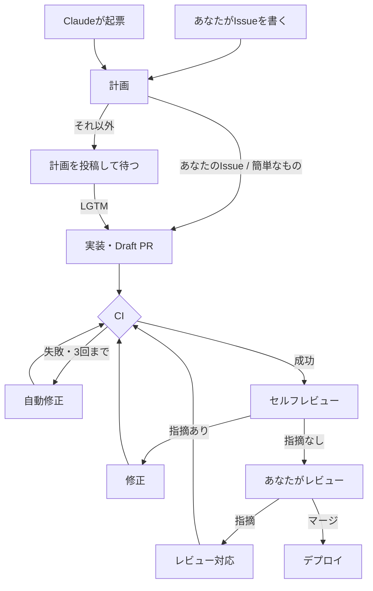

# Claude駆動開発フロー 仕様書

Nov 28, 2026 · @makibishi

## 概要

人間はIssueを書き、PRをレビューしてマージするだけで、計画から実装・テスト・CI修正・セルフレビューまではClaudeが担う。個人開発のWebアプリを対象に、Claude Maxのサブスク枠とGitHub Actionsの無料枠で運用する。

| 担当 | やること |
| --- | --- |
| 人間 | Issueを書く、Claudeが起票したIssueを承認する（`[LGTM]`）、Claudeの質問に答える、PRをレビューしてマージする |
| Claude | 計画、Issueの分割、実装、テスト、CIの自動修正、セルフレビュー、レビュー対応、コンフリクト解消、範囲外作業やflaky testの起票 |
| GitHub Actions | Claudeの起動、CI、mainへのマージ後のデプロイ |

あなたのIssueは承認なしで、Claudeが起票したIssueは、簡単なものはそのまま、それ以外は計画のあと `[LGTM]` で実装に進む。CIの自動修正は3回までで、セルフレビューを経てからあなたにレビューが回る。

## 全体構成

本体は共通ワークフローに集め、各アプリのリポジトリには呼び出し用の薄いファイルと設定だけを置く。改善は共通ワークフローを直すだけで全アプリに効く。

| 要素 | 置き場所 | 中身 |
| --- | --- | --- |
| 共通ワークフロー | `claude-devflow/workflow`（公開） | 計画・実装・PR対応・CI修正・セルフレビューの本体、`CLAUDE.md` の共通ルール、`setup.sh`、本仕様書（`docs/spec.md`）。`workflow_call` 形式で、`v1` などのタグでバージョン管理する。mainはRulesetsで保護する（PR必須・直接push禁止） |
| テンプレート | `claude-devflow/template`（公開） | 呼び出し用ファイル、Issue/PRテンプレート、`CLAUDE.md` の土台（プロジェクト固有部分の枠だけ）。できるだけ薄く保ち、改善が必要な場面を減らす |
| 動作確認用アプリ | `claude-devflow/sandbox`（非公開） | 共通ワークフローをタグではなく `main` の最新で呼び、改善を配る前に動作を確かめる |
| 呼び出し用ファイル | 各アプリの `.github/workflows` | 関係しそうなイベント（Issue、コメント、レビューなど）を広めに受け取り、`claude-devflow/workflow` を呼ぶだけ。反応するかどうかの判定は共通ワークフロー側で行う |
| 設定ファイル | 各アプリの `.github/devflow.yml` | デフォルトブランチ名（`master`）、モデル、上限など。承認者は指定がなければリポジトリのオーナー |
| `CLAUDE.md` | 各アプリのルート | プロジェクト固有部分（技術スタック、コマンド、規約）だけを書く。最初の要件定義でClaudeが書く。共通ルールは共通ワークフローから実行時にClaudeへ渡す（`--append-system-prompt-file`） |
| GitHub App | 公式のClaude GitHub App | ワークフローへの書き込み権限も含めてそのまま使う。個人アカウントとorganization `claude-devflow` のそれぞれで、全リポジトリにインストールする |
| 認証 | 各アプリと `template` のシークレット | `CLAUDE_CODE_OAUTH_TOKEN`（`claude setup-token` で発行、Maxの枠を使う）。アプリから `workflow` へ改善Issueを立てるためのトークン `DEVFLOW_ISSUE_TOKEN`（下記） |

アプリのリポジトリは個人アカウントの無料プラン・非公開を前提にする（共通ワークフローとテンプレートは公開）。共通ワークフロー・テンプレート・動作確認用アプリはorganization `claude-devflow` に置く。アプリは原則、1アプリ＝1リポジトリ（モノレポ）で管理する。全体はすべて日本語で運用し、コメント、PRの説明、コミットメッセージ、`CLAUDE.md` も日本語にする。

**改善Issueの起票用トークン**：アプリ側のClaudeはそのアプリのリポジトリ用の権限で動くため、`claude-devflow/workflow` にはそのままではIssueを立てられない可能性が高い。`workflow` へのIssue作成だけを許可したfine-grained PATを、各アプリにシークレットとして渡す。漏れてもできるのは公開リポジトリへのIssue作成だけなので、リスクは小さい。実際に必要かどうかは段階1の実装で検証する。

## Issueのフロー

あなたが立てたIssueは承認なしで実装に進み、Claudeが起票したIssueのうち簡単でないものだけが、先頭が `[LGTM]` のコメントでの承認を必要とする。起票元は投稿者で判別し、ラベルは使わない。

| 起票元 | 起票後の動き | 実装の開始条件 |
| --- | --- | --- |
| あなた | すぐに実装に進む。曖昧なときは、Claudeが自分の判断で質問して止まる | なし（起票した時点で承認済みとみなす） |
| Claude（簡単なもの） | 計画に「簡単と判断した理由」を書き、そのまま実装してPRを作る | なし |
| Claude（それ以外） | 計画をコメントで投稿して待つ | あなたの新規コメントの先頭が `[LGTM]` |

**簡単かどうかの判定**（計画の段階でClaudeが行い、共通ルールに明記する）

- 対象になる作業：誤字・文言の修正、lintやフォーマットの修正、テストの追加、1か所で完結する小さなバグ修正、依存パッケージのパッチ更新など
- 対象外にする作業：DBのスキーマやマイグレーション、認証・権限、課金、デプロイやワークフローの変更、外部に公開しているAPIの変更、依存パッケージのメジャー更新
- 迷ったら承認待ちにする
- 判断が違うと思ったら、計画のコメントを見た時点で止める。実装後の差分によるチェックは行わず、PRレビューで確認する

**コメントの判定ルール**

- メンションは不要。あなた（設定ファイルの承認者）のコメントには毎回反応する
- 先頭が `[MEMO]` のコメントには反応しない
- `[LGTM]`・`[MEMO]`・`[REVIEW REQUEST]` は、先頭の空白や改行を無視して判定し、大文字小文字は区別する
- 承認として扱うのはIssueへの新規投稿だけ。編集で追加した `[LGTM]` と、PR上の `[LGTM]` は無視する
- すでに実装中、またはPRがある場合、2回目の `[LGTM]` は無視する。二重起動は `concurrency`（Issue番号ごとに1つ）で防ぐ
- Claude自身のコメントでは起動しない。`CLAUDE.md` にも「`[LGTM]` という文字列を書かない」と明記する

コメントは毎回新しく起動したClaudeが読むので、決まったことはIssueに残す。ClaudeはIssue全体のやり取りを読んで状況を判断する。

## Claudeによる自動起票

Claudeが起票したIssueは、簡単なものはそのまま実装し、それ以外は計画まで自動で作って、実装はあなたの `[LGTM]` を待つ。起票の通知はしない。

| 場面 | 起票の仕方 |
| --- | --- |
| 実装中に見つかった範囲外の作業 | PRには含めず、別Issueに切り出す。本文に派生元（「#12 から派生」など）を書き、PRの説明にも切り出したIssueを載せる |
| flaky test | CIが1回失敗し、再実行で通ったらflakyとみなす。検出はスクリプトで行い、同じテストのIssueがあれば新規に立てず発生回数を追記する。原因の分析はHaikuが行う |
| 利用者のフィードバック | 取り込むかどうかは各アプリで判断する。本仕様の対象外 |
| 大きすぎるIssue | サブIssueに分割する（下記） |

**起票側の歯止め**：1回の実行で起票できる数に上限を設け、似たIssueがすでにないか確認してから立てる。Claudeは自分のコメントでは起動しないので、起票の連鎖は計画の段階で止まる。

**サブIssueとブランチ戦略**

1. 親Issueで、Claudeが分割案とブランチ戦略（どれを直列、どれを並列にするか）を決める
2. サブIssueはClaudeが起票したIssueとして扱う。簡単なものは承認なしで進め、それ以外は1件ずつ `[LGTM]` で承認する
3. 必ず1 Issue＝1ブランチで進める
4. 直列のものは、前のサブIssueがマージされてから、masterの最新からブランチを切る。並列でいいものは同時に進める

## PRのフロー

人間にレビューが回ってくるのは、CIが通り、Opusのセルフレビューを経たあとだけ。

1. Claudeが `claude/` で始まるブランチで実装し、Draft PRを作る。PRの説明には `Closes #<Issue番号>` を書く
2. CIが失敗したらClaudeが自動で修正する。**上限は3回**で、超えたらメンションで通知して止める
3. CIが通ったら、Opusがセルフレビューする（1回だけ）
4. 指摘があればSonnetが修正し、もう一度CIを通す。ここでのCI失敗も、自動修正の3回の上限に含めて数える
5. Ready for reviewにし、あなたをレビュアーに指定する
6. あなたがレビューを送信すると、Claudeが修正をpushする。インラインコメントをまとめて送信すれば、1回の起動で全部に対応する
7. Claudeはスレッドごとに返信し、対応済みのスレッドだけを解決済みにする。残った未解決スレッドが、人間の確認が必要な箇所になる
8. あなたがマージすると、Issueが自動で閉じ、デプロイが走る

**コンフリクト**：Claudeが自分で解消する。push済みのブランチはrebaseせず、masterをマージして直す。

**マージ方式**：通常のマージ（マージコミットを作る方式）を標準にする。ブランチの自動削除は各アプリのリポジトリ設定に任せる。

**人間のPRでの会話**：自分で作ったPR（`claude/` 以外のブランチ）では、`@claude` を含むコメントにだけ返信する。質問への回答や調査をコメントで返し、修正を頼まれても直し方を `suggestion` で示すだけで、pushはしない。人間のPRのブランチをClaudeが変更することはない。

**依頼されたレビュー**：PRに先頭が `[REVIEW REQUEST]` のコメントを書くと、Opusがレビューする。自分で作ったPRのレビューにも、ClaudeのPRのセルフレビューだけでは不安なときのダブルチェックにも使える。指摘は行ごとのインラインコメントで返し、狭い範囲で直し方が明確なものは `suggestion` で提案する（UIからコミットできる）。Claudeはpushしない。ClaudeのPRで指摘を直させたいときは、続けてレビューかコメントで頼む。

**並列実行**：件数の制限は設けない。無料プランの同時20ジョブの範囲で動かす。

## モデルの割り当て

計画はFable（使えなければOpus）、実装はSonnet、セルフレビューはOpus、軽い作業はHaikuに割り当てる。実装とセルフレビューでモデルを分け、思い込みに引きずられないチェックにする。

| 工程 | モデル | 指定 |
| --- | --- | --- |
| 計画・設計・Issueの分割 | Fable（使えなければOpus） | `best` |
| 実装・CIの自動修正・レビュー対応・コンフリクト解消 | Sonnet | `sonnet` |
| セルフレビュー・依頼されたレビュー | Opus | `opus` |
| 軽い作業（CIログの要約、flaky testの原因分析など） | Haiku | `haiku` |

**Fableの注意点**：プランによっては、Fableの利用がプランの枠ではなく追加の利用クレジットから課金される。GitHub Actionsのような非対話モードでは確認なしで課金されるため、導入前にClaude Codeの `/model` でFableの行に「Requires usage credits」が出ていないか確認する。出ていたら計画も `opus` にする。

1回あたりのターン数の上限（`--max-turns`）は、運用しながら決めて設定ファイルで指定する。

## 通知のルール

あなたの対応が必要なときだけ通知し、IssueやPRの起票では通知しない。

| 場面 | 通知の方法 |
| --- | --- |
| Claudeが質問するとき | コメントであなたをメンションする |
| PRがレビュー可能になったとき | あなたをレビュアーに指定する |
| CIの自動修正が3回を超えたとき | メンションして止める |
| Maxの利用上限に達したとき | メンションする。再実行はGitHub Actionsの「Re-run jobs」で行う |
| Issue・PRの起票 | 通知しない |

利用上限の通知は、Claudeではなく失敗時に動く別の処理（`gh` コマンド）から送るので、Claudeの枠が尽きていても届く。再実行したClaudeは最初からやり直すが、途中までpushした内容を読んで続きから作業する。

## デプロイ

main（master）へのマージをきっかけに、GitHub Actionsでデプロイする。デプロイの手段は各アプリで自由に選び、共通の制約は設けない。

- デプロイ用のワークフローは各アプリのリポジトリに置き、Claudeが直接改善できる
- デプロイ用のシークレットは、デプロイのジョブでだけ参照し、PRのCIでは参照しない
- 同じデプロイ先を複数のアプリで使うようになったら、共通ワークフローに切り出すことも検討する

各アプリで推奨する対策は「セキュリティ方針」にまとめる。

## セキュリティ方針と受け入れたリスク

Claudeの権限は制限せず、PRレビューを最後の砦とする。無料・非公開のリポジトリではブランチ保護とEnvironmentsが使えないため、次のリスクを受け入れる。

| 受け入れるリスク | 内容 | 補う対策 |
| --- | --- | --- |
| PRのブランチからシークレットを読める | PRのブランチでワークフローが書き換えられると、レビュー前にシークレット付きで実行される | 各アプリでOIDC、またはデプロイ先のGitHub連携を使い、デプロイ用のシークレットを置かない |
| mainへの直接push | pushされるとレビューなしでデプロイが走る | `CLAUDE.md` に「mainに直接pushしない」を明記、デプロイ時に通知する |
| `CLAUDE_CODE_OAUTH_TOKEN` の流出 | PRのワークフローからも読め、漏れるとMaxの枠を使われる | 漏れたらトークンを再発行する |

**各アプリでの推奨対策**

- デプロイ先がOIDCに対応していれば、「mainからの実行だけを信頼する」と設定する
- デプロイ用のトークンは、そのアプリへのデプロイだけに権限を絞る
- 本番とプレビューで認証情報を分ける
- クラウドの予算アラートと、デプロイの通知を入れる
- `CLAUDE.md` に「シークレットを出力したり外部に送ったりしない」「flakyなテストを削除やskipで解決しない」を明記する

外部からの入力（利用者のフィードバックなど）を取り込むアプリでは、プロンプトインジェクションの恐れがある。そのIssueは計画をよく読んでから `[LGTM]` する。

**共通ワークフローとテンプレートの公開**

共通ワークフローはシークレットを持たず、テンプレートに登録するトークンも、テンプレートから作ったリポジトリやフォークからのPRには渡らないため、どちらも公開する。公開により、全アプリが実行する共通ワークフローのmainを無料で保護でき、別のorganizationからもコピーなしで呼び出せる。

- 共通ワークフロー用リポジトリに起票するIssueには、アプリ固有の情報（コード、エラー内容、アプリ名）を書かず、ワークフローの問題として一般化して書く。共通ルールに明記する
- 承認者は、設定ファイルで指定がなければリポジトリのオーナーとみなす。設定ファイルで指定するのは、organizationで複数人を承認者にするときなど上書きが必要な場合だけ。リポジトリ名は実行時にGitHubから取得し、どこにも書かない
- 他人からのIssueやPRは承認者の判定でジョブごとスキップされ、実行時間も消費しない。フォークからのPRにはシークレットも渡らないので、放置してよい

将来、非公開のまま守りを固めたくなったら、GitHub Proを契約してEnvironments（mainだけが使えるシークレット）を追加する。構成を変えずに後から足せる。

## 運用

**利用枠と実行時間**

- Claudeの利用枠：Maxのサブスク枠を、普段のチャットや手元のClaude Codeと共有する。5時間ごとの枠と週の上限がある
- GitHub Actions：無料プランの非公開リポジトリは月 2,000分まで。1 Issueあたり30〜40分なら、月 50件前後が目安
- 実行時間を使い切ると全ジョブが止まり、失敗の通知も届かない。残り時間を定期的に確認する

**トークンの更新**

`claude setup-token` のトークンは有効期限1年で、無期限や自動更新はできない。期限の前に作り直し、`setup.sh` の「トークンだけ全リポジトリで差し替える」機能で一括更新する。

**新しいアプリの作成**

1. テンプレートリポジトリからリポジトリを作る
2. `setup.sh` を実行し、シークレットを登録する
3. 最初の要件定義で、Claudeに技術スタック・CI・`CLAUDE.md` の固有部分を作らせる
4. 土台ができてから、1 Issue＝1機能くらいの単位で回し始める

**既存リポジトリへの導入**

導入作業そのものをClaudeにやらせ、PRで受け取る。Claudeが既存のコードを読み、呼び出し用ファイルと `CLAUDE.md` を追加する（既存の `CLAUDE.md` は統合する）。別のorganizationに入れる場合、非公開の共通ワークフローは呼び出せないため、公開するかコピーを置く。他の人もいるorganizationでは、認証をAPIキーに切り替える。

**ワークフローの改善**

- 共通ワークフローの改善も、共通ワークフロー用リポジトリで同じフローに乗せてClaudeに任せる
- アプリで作業中のClaudeが不具合や改善点に気づいたら、共通ワークフロー用リポジトリ（claude-devflow/workflow）にIssueを起票する
- claude-devflow/sandbox だけはタグではなく `main` の最新を呼ぶ。そこで動作を確認してからタグを更新し、全アプリに配る

**テンプレートの改善**

- テンプレートのリポジトリにもシークレットを登録し、アプリと同じフローでClaudeに改善させる
- 共通ルールと `setup.sh` は共通ワークフロー側にあるので、その改善は次の実行から全アプリに反映される
- `setup.sh` は何度実行しても同じ結果になるように作る。呼び出し用ファイルの変更が必要になったら、各アプリで再実行し、差分をPRとして出す

## 未決事項

残りは実装しながら決める細部だけで、構成を左右する未決事項はない。

- [x] Claude Codeの `/model` で、Fableが追加の利用クレジット課金になるか確認する（確認のうえ `best` を使う）
- [ ] 工程ごとの `--max-turns` の値を決める（初期値：計画30、実装100、セルフレビュー30、軽作業10）
- [ ] Claudeが1回の実行で起票できるIssue数の上限を決める（初期値：3）
- [ ] GitHub Actionsの残り実行時間を確認する方法を決める
- [ ] 各アプリのデプロイ先と、OIDCが使えるかをアプリごとに決める
